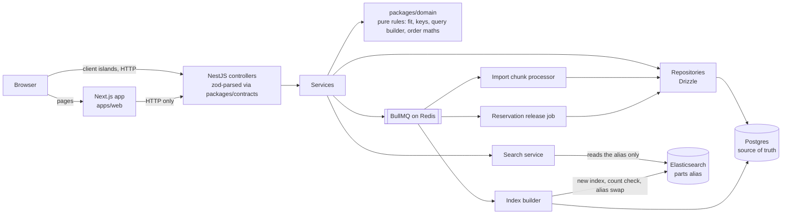

# passform

A compatibility-driven parts catalogue and ordering backend, built as a
standalone portfolio project. Search filters on what fits a vehicle before
it ranks anything, an ingestion pipeline imports supplier catalogues
without taking search down, and order creation stays correct under retries
and races. NestJS + PostgreSQL (Drizzle) + Elasticsearch + BullMQ + Redis,
with a thin Next.js client that talks to the API over HTTP like any other
consumer. Everything runs locally on docker-compose.

All data is synthetic. Every vehicle make, model, parts brand and supplier
is invented by a seeded generator; any resemblance to a real one is
coincidental. The project is not affiliated with any vehicle maker, parts
brand, catalogue provider or retailer.


## Quick start

Requires Node 22.18 or later and Docker.

```sh
git clone https://github.com/husnukirci/passform.git && cd passform
npm ci
cp .env.example .env
docker compose up -d
npm run db:setup
npm run dev
```

`db:setup` applies the migrations, generates the `small` synthetic profile
(2,000 vehicle variants, 5,000 parts) into `.data/small`, seeds Postgres
from it and builds the Elasticsearch `parts` alias from the seeded rows.
The web app is then at `http://localhost:3000` and the API at
`http://localhost:4000`; Bull Board is at `http://localhost:4000/admin/queues`.

To try the flows the screenshots show: enter registration key `1103` /
`003` on the start page (it resolves to two variants and asks which), pick
one, filter the results, open a part, add it to the cart, place the order,
then press **Send again** on the order page. To watch an import, generate a
supplier file and start it from `/imports`:

```sh
npm run data:generate-import -- --rows 2500 --from .data/small
```

The `large` profile (50,000 variants, 2,000,000 parts, 22.8 million
fitment rows) is what the numbers below were measured on:

```sh
npm run data:generate -- --profile large
npm run db:seed -- --from .data/large
npm run index:rebuild
```

## What it does

**Fit-constrained search.** A vehicle is identified by a two-part
registration key that may resolve to several variants, and the client asks
rather than guesses. Every part carries fitment rows (variant, optional
build window, axle, equipment code); search puts the fitment match in
Elasticsearch's filter context and ranks only what survived, so a strong
text match can never outrank a wrong fitment. Each hit comes back with a
verdict (`fits`, `ask`, `no`) and a sentence explaining it, computed by the
same pure function the results page shows.

**Imports that keep search up.** A supplier file is split into 1,000-row
chunks, each an idempotent BullMQ job identified by `(importId, seq)`;
re-running a finished chunk is a no-op, a bad row is data rather than a
failure, and a chunk that fails every retry lands in a dead-letter queue.
When the file is in, the index is rebuilt into a new physical index,
count-verified against Postgres, and swapped in behind the `parts` alias in
one atomic call. Search answers from the old index until that moment.

**Orders that survive retries and races.** `POST /orders` requires a
client-chosen `Idempotency-Key`; a repeat with the same body returns the
stored response byte for byte, a repeat with a different body is a `409`.
Stock is taken with `UPDATE ... WHERE stock_qty >= qty` inside the order
transaction, so two buyers cannot both get the last unit and no
application lock exists. A reservation expires after fifteen minutes
unless confirmed; a repeatable job puts the stock back.

## Architecture



The web app has no database, Redis or Elasticsearch access; server
components and client islands alike go through `apps/web/src/lib/api.ts`
and parse every response with the same zod schema the API serialises with.
Postgres holds every fact. Elasticsearch is a derived, rebuildable
projection read only through the alias. Business rules live in
`packages/domain`, plain TypeScript with no framework imports, and ESLint
enforces the ban. Controllers parse and delegate; processors load, call the
domain and persist.

## Numbers

Measured once on the final code on an Apple M4 Pro with the compose
services in Docker; the full tables, the machine and the commands are in
[docs/numbers.md](docs/numbers.md), and the figures cite the commit they
were measured on.

| Figure                                                           |                       Value |
| ---------------------------------------------------------------- | --------------------------: |
| `large` profile generation (2,000,000 parts, 22.8 M fitments)    |                       9.7 s |
| `large` profile seed (`COPY`, indexes and foreign keys in place) |                     345.5 s |
| Index rebuild, create to alias swap                              |                     124.0 s |
| Index: parts / Lucene documents (with nested rows) / size        | 2,000,000 / 24.8 M / 1.3 GB |
| Largest `fitments` array on one part                             |                          20 |
| 500,000-row supplier import through the queue                    |      125.2 s (3,995 rows/s) |
| `GET /search` every 200 ms during that import and its swap       |       328 requests, all 200 |
| 1,000-row price-and-stock delta through the fast path (P9)       | 0.23 s (first request 0.87) |
| Lighthouse (production build): accessibility / best practices    |          100 / 100, 4 pages |

The import rate sits on the worker's limiter by design (four chunk starts
per second); the chunk transaction itself is not the bound.

## Tech choices

Each is recorded as a short Nygard-style entry in
[docs/decisions.md](docs/decisions.md).

| Choice                                                                    | ADR                                                                                                               |
| ------------------------------------------------------------------------- | ----------------------------------------------------------------------------------------------------------------- |
| Separate NestJS API and thin Next.js client in one monorepo               | [1](docs/decisions.md#adr-1-separate-nestjs-api-and-thin-nextjs-client-in-one-monorepo)                           |
| Drizzle over TypeORM or Prisma                                            | [2](docs/decisions.md#adr-2-drizzle-in-nestjs-over-typeorm-or-prisma)                                             |
| Domain core as a pure, isomorphic TypeScript package                      | [3](docs/decisions.md#adr-3-domain-core-as-a-pure-isomorphic-typescript-package)                                  |
| Fitment is a filter, never a score                                        | [4](docs/decisions.md#adr-4-fitment-is-a-filter-never-a-score)                                                    |
| Fitments as nested documents on the part                                  | [5](docs/decisions.md#adr-5-fitments-as-nested-documents-on-the-part)                                             |
| Postgres is the source of truth; Elasticsearch is rebuilt behind an alias | [6](docs/decisions.md#adr-6-postgres-is-the-source-of-truth-elasticsearch-is-derived-and-rebuilt-behind-an-alias) |
| Deterministic generator with size profiles; all names invented            | [7](docs/decisions.md#adr-7-deterministic-generator-with-size-profiles-all-names-invented)                        |
| Chunked, idempotent import jobs with a dead-letter queue                  | [8](docs/decisions.md#adr-8-chunked-idempotent-import-jobs-on-bullmq-with-a-dead-letter-queue)                    |
| Idempotency keys with stored-response replay                              | [9](docs/decisions.md#adr-9-idempotency-keys-for-order-creation-with-stored-response-replay)                      |
| Stock reservation by conditional update; expiry as compensation           | [10](docs/decisions.md#adr-10-stock-reservation-by-conditional-update-expiry-as-compensation)                     |
| Slow and fast index paths                                                 | [11](docs/decisions.md#adr-11-slow-and-fast-index-paths)                                                          |
| Local-first infrastructure; deployment deferred                           | [12](docs/decisions.md#adr-12-local-first-infrastructure-deployment-deferred-to-tier-3)                           |
| zod via nestjs-zod, schemas shared through `packages/contracts`           | [13](docs/decisions.md#adr-13-zod-via-nestjs-zod-with-the-schemas-shared-through-packagescontracts)               |
| Workspace packages consumed as TypeScript source                          | [14](docs/decisions.md#adr-14-workspace-packages-are-consumed-as-typescript-source)                               |
| The browser calls the API directly; the URL owns the vehicle              | [15](docs/decisions.md#adr-15-the-browser-calls-the-api-directly-the-url-is-the-vehicles-one-home)                |

## Repository

```
apps/api                NestJS API (ESM, Node 22)
  src/vehicles          registration-key resolution, variant lookups
  src/catalog           categories, suppliers, part detail
  src/search            mapping, index builder, alias swap, search service
  src/imports           splitter, chunk processor, completion, rebuild processor
  src/orders            order transaction, confirm, reservation release job
  src/infra             Drizzle schema and client, queues, error filter
  scripts/              generator, import-file generator, seeder, migrate, index rebuild
  drizzle/              committed migrations
  test/                 integration tests against the compose services
apps/web                Next.js App Router client
  src/app               /, /parts, /parts/[sku], /cart, /orders/[id], /imports
  src/lib/api.ts        the only path to the API
  src/state             cart store (Zustand, persisted)
packages/domain         pure rules, strict TDD, zero framework imports
packages/contracts      zod schemas for every request and response body
docs/api.md             every endpoint, with responses the API returned
docs/decisions.md       ADRs 1–15
docs/numbers.md         measured figures and the machine they came from
docs/ai-workflow.md     friction log, per-phase narrative, reflection
docs/superpowers/specs  the design spec the plan was written from
PLAN.md · PHASES.md     tiers, build order, nine self-contained phase specs
CLAUDE.md               the working agreement the phases were built under
```

## Scripts

| Script                         | What it does                                                 |
| ------------------------------ | ------------------------------------------------------------ |
| `npm run dev`                  | API and web app together, with the root `.env` loaded        |
| `npm run lint`                 | ESLint over every workspace                                  |
| `npm run typecheck`            | `tsc -b` over the project references                         |
| `npm test`                     | Unit tests in every workspace                                |
| `npm run test:integration`     | API integration tests against the docker-compose services    |
| `npm run build`                | Builds every workspace                                       |
| `npm run db:migrate`           | Applies the committed Drizzle migrations                     |
| `npm run data:generate`        | Generates a dataset (`--profile small\|large`, `--out DIR`)  |
| `npm run data:generate-import` | Writes a supplier import file (`--rows N --supplier s_01`)   |
| `npm run db:seed`              | Seeds the catalogue from a dataset directory (`--from DIR`)  |
| `npm run index:rebuild`        | Rebuilds the `parts` index from Postgres and swaps the alias |
| `npm run db:setup`             | migrate → generate small → seed → index rebuild              |

## Testing

Four tiers, stated in [PLAN.md](PLAN.md) so each is a decision rather
than a gap. `packages/domain` is strict red-green-refactor: every rule has
a test that was seen failing first. Services and controllers get unit
tests with repositories stubbed. Repositories, processors, the index
builder, the search service and the order transaction (including its
concurrency guarantees: ten concurrent requests under one key, two buyers
for the last unit) get integration tests against the compose services.
Presentational components get one smoke test per page and manual QA. CI
runs all of it, with the same three services as containers, on every push.

## Process

The build was tiered and phased so the project was releasable at every
milestone: [PLAN.md](PLAN.md) has the tiers and the definition of done,
[PHASES.md](PHASES.md) the nine self-contained phase specs, one per
session and PR. Load-bearing choices are in
[docs/decisions.md](docs/decisions.md). The project was pair-built with
Claude Code under the agreement in [CLAUDE.md](CLAUDE.md);
[docs/ai-workflow.md](docs/ai-workflow.md) logs, one line at the time it
happened, where generated output was wrong and what caught it, and closes
with a narrative and an honest reflection. The REST contract is in
[docs/api.md](docs/api.md), every example a response the running API
returned.

## Roadmap

Tier 1 (`v1.0.0`) is complete. Tier 2 and 3 items are follow-ups, not
prerequisites, and may never ship; they are listed in [PLAN.md](PLAN.md)
so cuts are deliberate:

- **Tier 2:** the supplier price-and-stock endpoint on the fast index path
  (shipped in Phase 9); saved vehicles; an append-only event log (search
  impressions, orders, returns) on a local DynamoDB and the return-rate
  view that names parts whose fitment data to distrust.
- **Tier 3:** an API gateway with keys and rate limits in front of the read
  API, infrastructure as code, cloud deployment, authentication.

## Licence

[MIT](LICENSE).
